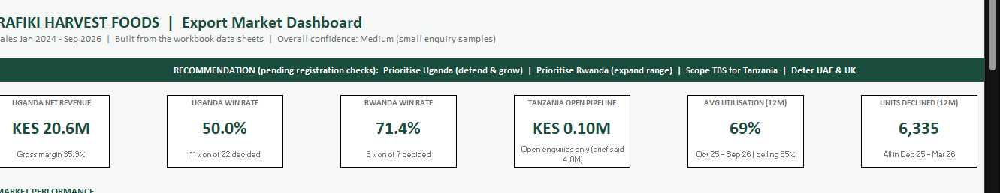
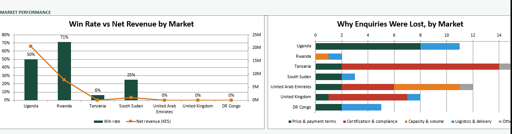
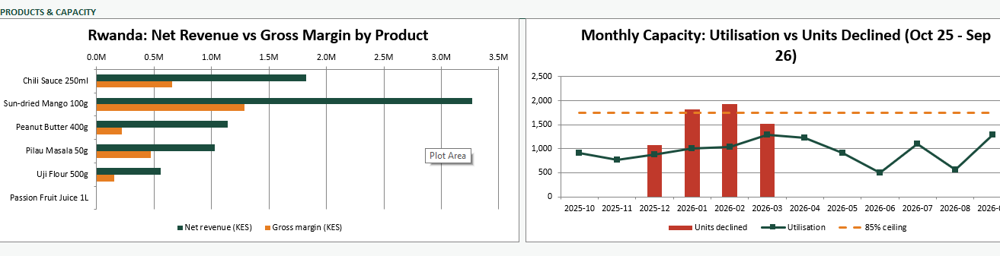
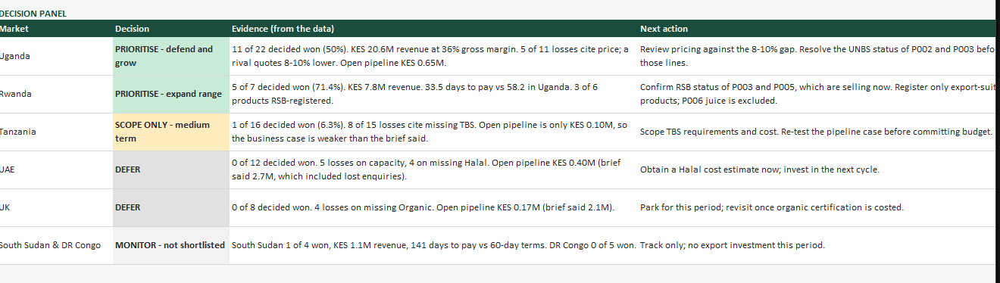
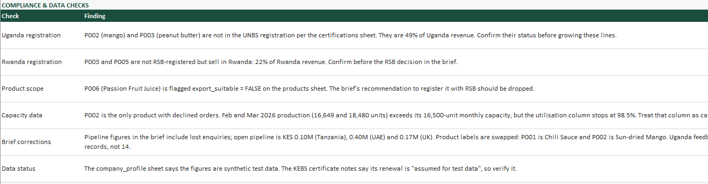

# Rafiki Harvest Foods: Export Market Prioritisation

This project answers one question for Rafiki Harvest Foods: **which export markets should the company prioritise over the next six months (October 2026 to March 2027), and how should it position its products there?**

The project has three parts:

1. **The Market Intelligence Brief** (PDF). The written findings and recommendations for leadership.
2. **The data workbook** (`.xlsm`). The source tables, a VBA macro, and a dashboard that rebuilds the findings from the data.
3. **This README.** A guide through the brief's findings, the workbook, the data dictionary, and the checks made against the raw data.

The README follows the same section order as the brief, so you can read the two side by side.

## Contents

1. [Project at a glance](#project-at-a-glance)
2. [Quick start: running the dashboard](#quick-start-running-the-dashboard)
3. [Project contents](#project-contents)
4. [Section 1: Research brief summary](#section-1-research-brief-summary)
5. [Section 2: Executive summary](#section-2-executive-summary)
6. [Section 3: Detailed insights](#section-3-detailed-insights)
7. [Section 4: Strategic implications and decision guidance](#section-4-strategic-implications-and-decision-guidance)
8. [Section 5: Recommended next steps](#section-5-recommended-next-steps)
9. [Section 6: Evaluation summary](#section-6-evaluation-summary)
10. [Section 7: Evidence log](#section-7-evidence-log)
11. [Section 8: Closing executive summary](#section-8-closing-executive-summary)
12. [Data verification: what was checked against the raw data](#data-verification-what-was-checked-against-the-raw-data)
13. [Data dictionary](#data-dictionary)
14. [Metric definitions](#metric-definitions)
15. [Loss reason mapping](#loss-reason-mapping)
16. [Known data issues and limitations](#known-data-issues-and-limitations)

---

## Project at a glance

| Item | Detail |
|---|---|
| Company | Rafiki Harvest Foods Ltd (Thika, Kiambu County, Kenya) |
| Horizon | October 2026 to March 2027 (6 months) |
| Data period | January 2024 to September 2026 |
| Currency | Kenya shillings (KES) unless stated |
| Products | 6 product lines (Chili Sauce, Sun-dried Mango, Peanut Butter, Pilau Masala, Uji Flour, Passion Fruit Juice) |
| Markets assessed | Uganda, Rwanda, Tanzania, South Sudan, UAE, UK, DR Congo |
| Overall confidence | Medium. Small enquiry samples (8 to 26 per market) and no external market-size data for Rafiki's categories |
| Classification | Confidential, leadership use only |

**Bottom line:** Prioritise **Uganda** (defend and grow) and **Rwanda** (expand the product range). **Scope** TBS certification for Tanzania as a medium-term option. **Defer** the UAE and UK, which are blocked by missing Halal and Organic certification.

### Evidence: dashboard headline cards

*Dashboard view 1. The `Dash_Rafiki` headline cards, built by the macro from the source sheets. Tanzania's open pipeline reads KES 0.10M, not the brief's KES 4.0M (see Section 3, I3).*

---

## Quick start: running the dashboard

**Requirements:** Microsoft Excel for Windows with macros enabled.

1. Open `rafiki_harvest_foods_dataset.xlsm`. If the file is `.xlsx`, use **File > Save As > Excel Macro-Enabled Workbook** first. Macros cannot be saved in `.xlsx`.
2. If Excel shows a security bar, click **Enable Content**. If the file opens in Protected View, click **Enable Editing** first. If the file was downloaded, right-click it in File Explorer, open **Properties**, tick **Unblock**, and reopen it.
3. Press **Alt+F11**, open the module that contains `BuildRafikiDashboard`, place the cursor inside the procedure, and press **F5**.
4. Wait for the message "Dashboard built from the workbook sheets."

The macro creates two new sheets, `Dash_Rafiki` (the dashboard) and `Calc_Rafiki` (the calculations). It reads the six source sheets directly and does not import any files. Running it again rebuilds only these two sheets. Other sheets are not changed.

**Required source sheets:** `sales_orders`, `products`, `export_enquiries`, `production_capacity`, `certifications`, `customer_feedback`. If any is missing, the macro stops and names it.

---

## Project contents

**Screenshots (evidence):** the `screenshots/` folder holds five captures of the working dashboard, referenced in Sections 2 to 4 and the data-verification section:

| File | Shows | Used in |
|---|---|---|
| `screenshots/01_dashboard_kpi_cards.png` | Headline KPI cards | Project at a glance |
| `screenshots/02_market_performance_charts.png` | Win rate vs revenue; loss reasons | Section 3 |
| `screenshots/03_products_and_capacity_charts.png` | Rwanda products; monthly capacity | Section 3, I4 |
| `screenshots/04_decision_panel.png` | Decision panel | Section 4 |
| `screenshots/05_compliance_and_data_checks.png` | Compliance and data checks | Data verification |

| File or sheet | Purpose |
|---|---|
| `market_intelligence_brief.pdf` | The written brief: findings, recommendations, evidence log |
| `rafiki_harvest_foods_dataset.xlsm` | Workbook with the source tables, the VBA macro, and the generated dashboard |
| `csvs.zip` | CSV exports of the same tables (sales, enquiries, production capacity, products, certifications, customer feedback) |
| `README.md` | This guide |
| `sales_orders` (sheet) | Order-line sales data, January 2024 to September 2026 |
| `products` (sheet) | Product master: prices, costs, shelf life, export suitability |
| `export_enquiries` (sheet) | International buyer enquiries with outcome and loss reason |
| `production_capacity` (sheet) | Monthly capacity, production, utilisation, and declined orders by product |
| `certifications` (sheet) | Certifications held, in progress, or not held |
| `customer_feedback` (sheet) | Buyer and customer comments with sentiment |
| `customers` (sheet) | Customer master |
| `company_profile` (sheet) | Company context. Its own notes say the figures are synthetic test data |
| `Dash_Rafiki` (sheet, generated) | Dashboard: KPI cards, four charts, decision panel, compliance checks |
| `Calc_Rafiki` (sheet, generated) | All calculations behind the dashboard (formulas only) |
| `Dashboard`, `Data` (sheets) | Earlier draft versions. Safe to delete once `Dash_Rafiki` has been checked |

---

## Section 1: Research brief summary

The brief set out to identify one to two export markets to prioritise over the next six months and to recommend how to position Rafiki in them.

| Item | Detail |
|---|---|
| Objective | Identify 1 to 2 export markets to prioritise and recommend competitive positioning |
| Scope | 6 product lines across 7 pipeline markets |
| Timeframe | October 2026 to March 2027 |
| Constraints | Low budget. 85% utilisation ceiling (average about 69% today). No TBS, Halal or Organic certification held |
| Success criteria | A ranked shortlist of 1 to 2 markets, backed by evidence, with positioning guidance |
| Internal data | CRM/ERP, January 2024 to September 2026: enquiries, orders, capacity, certifications, feedback |
| External data | UN COMTRADE (2024 to 2025), USDA GAIN and FAIRS reports (Uganda, Rwanda, Tanzania), Rwanda NIS via UNDP |
| Key assumption | "Low budget" means certification spending must be sequenced, not run in parallel |

---

## Section 2: Executive summary

**Recommendation:** Prioritise Uganda and Rwanda for October 2026 to March 2027. Uganda gives the largest revenue base. Rwanda has the highest conversion rate and the fastest payment. Tanzania holds a pipeline but is blocked by certification gaps, so begin scoping only. Defer the UAE and the UK.

### Key insights at a glance

| ID | Insight | Key figure | Confidence |
|---|---|---|---|
| I1 | Uganda is the strongest market by volume, revenue and product breadth, but faces price pressure from a competitor quoting 8 to 10% lower per carton | 11 of 22 decided won (50%); KES 20.6M revenue | Medium |
| I2 | Rwanda has the highest win rate and the most positive buyer feedback, with room to expand the range through RSB registration | 5 of 7 decided won (71.4%); KES 7.8M revenue | Medium |
| I3 | Tanzania has strong demand but is blocked by TBS certification and Swahili labelling gaps. 12 of 15 losses are compliance-driven | 1 of 16 decided won (6.3%) | Medium |
| I4 | Spare production capacity (about 30% headroom) supports export growth, but line-level bottlenecks caused 6,335 units of declined orders in peak months | Average utilisation 69%; 6,335 units declined | Medium |
| I5 | UAE and UK are blocked by missing Halal and Organic certification, neither achievable within six months on a low budget | UAE 0 of 12 won; UK 0 of 8 won | Medium |

> **Verification note:** The brief's headline numbers reconcile with the source data. Some pipeline values and product labels do not. See [Data verification](#data-verification-what-was-checked-against-the-raw-data) before using the brief's pipeline figures.

---

## Section 3: Detailed insights

### Evidence: market performance and loss reasons

*Dashboard view 2. Left: win rate (columns) against net revenue (line, right axis) by market. Uganda leads on revenue and Rwanda on conversion. Right: why enquiries were lost, by market and category. Tanzania's losses are dominated by certification and compliance.*

### I1: Uganda, strongest export market but price-competitive

- **Revenue:** KES 20.6M net revenue, the largest of any market. Gross margin about 36% (KES 7.4M). Average 58.2 days to pay.
- **Win rate:** 11 of 22 decided enquiries won (50%). 26 enquiries in total.
- **Losses:** 11 lost. 5 cite price, 3 cite delivery lead time, 3 cite payment terms.
- **Competition:** Buyer feedback repeatedly flags an alternative supplier quoting 8 to 10% lower per carton.
- **Product breadth:** All five export products sold in Uganda.
- **Limitations:** Small sample (26 enquiries). No direct competitor pricing or quality data.

**Verified against the data:** Revenue, win rate and loss reasons all match. The brief's 58.2-day payment figure also matches, but Uganda's standard payment terms are 45 days, so buyers are paying about 13 days late on average. Uganda's open pipeline is KES 0.65M. The brief does not state this.

**Compliance flag (new):** The certifications sheet records P002 (Sun-dried Mango) and P003 (Peanut Butter) as not in the UNBS registration. Together they make up about 49% of Uganda's revenue. The brief does not mention this. Confirm the status before growing these lines.

### I2: Rwanda, highest win rate, most positive buyer sentiment, growth economy

- **Win rate:** 5 of 7 decided won (71.4%). 8 enquiries in total, 1 still open.
- **Revenue:** KES 7.8M net revenue across five products. Gross margin about 36%.
- **Payment:** 33.5 days average, against 58.2 in Uganda.
- **Buyer feedback:** Positive, including "strong repeat demand" and "happy with delivery reliability compared with other suppliers."
- **Registration:** 3 of 6 products are RSB-registered (P001 Chili Sauce, P002 Sun-dried Mango, P004 Pilau Masala). P003 and P005 are not.
- **Economy (external):** GDP growth of 9.4% in 2025 and 10% in Q1 2026 (Rwanda NIS via UNDP).
- **Limitations:** Very small sample (8 enquiries). RSB registration cost and timing not yet confirmed.

**Verified against the data:** Win rate, revenue, and payment days match. Pilau Masala has the highest margin rate (about 46%).

**Compliance flag (new):** P003 and P005 are not RSB-registered but are being sold in Rwanda. They account for about 22% of Rwanda revenue. Confirm this before making the RSB decision.

### I3: Tanzania, strong demand blocked by TBS certification gap

- **Enquiries:** 18 in total, the second highest.
- **Win rate:** 1 of 16 decided won (6.3%).
- **Losses:** 15 lost. 8 cite missing TBS certification, 4 cite labelling and language (Swahili text, importer details), 2 cite price, 1 has no buyer follow-up.
- **Compliance-driven:** 12 of 15 losses (80%).
- **Buyer quote:** "Cannot clear products at the border without local standards certification."

**Corrected against the data:** The brief describes the KES 4.0M as the "pipeline (2 open enquiries)." That figure is the estimated value of all 18 enquiries, including lost ones. The two open enquiries are worth **KES 0.10M**. The business case for Tanzania is therefore weaker than the brief states. Re-test it before committing budget.

### I4: Production capacity supports export growth, with line-level constraints

*Evidence: dashboard views 3 and 4 for this insight.*

*Dashboard views 3 (left) and 4 (right). Left: Rwanda net revenue and gross margin by product. Sun-dried Mango (P002) leads revenue. Right: monthly utilisation against the 85% ceiling, with declined units in the peak months (December to March). The declined units all sit on P002.*

- **Utilisation:** Average about 69% over the last 12 months (October 2025 to September 2026), against an 85% sustainable maximum.
- **Declined orders:** 6,335 units declined in December 2025 to March 2026, the peak domestic months.
- **Off-peak window:** April to August 2026 ran at roughly 60 to 74% with no declined orders. This is the best window for export production.

**Verified against the data:** Average utilisation (69.1%) and the 6,335 declined units both match.

**Finding the brief did not make:** All declined units are on **P002 (Sun-dried Mango)**, the only product with declined orders. P002 is the bottleneck. The brief refers only to "line-level constraints." Its capacity data also has an error: in February and March 2026, P002's units produced (16,649 and 18,480) exceed its 16,500-unit monthly capacity, but the utilisation column stops at 98.5%. Treat that column as capped.

### I5: UAE and UK blocked by certification gaps, defer beyond six months

- **UAE:** 0 of 12 decided won. 5 losses on capacity and peak-season volume, 4 on missing Halal certification, 2 on price, 1 on packaging and shelf life.
- **UK:** 0 of 8 decided won. 4 losses on missing Organic certification, 2 on minimum volume and compliance documents, 1 on logistics cost, 1 on price.
- **Buyer quote (UK):** "Interested only if products carry organic certification."

**Corrected against the data:** The brief gives UAE pipeline as KES 2.7M and UK as KES 2.1M. Those are totals for all enquiries, including lost ones. Open pipeline is **KES 0.40M** for the UAE and **KES 0.17M** for the UK.

**Why "defer" is not "abandon":** Halal certification would open the UAE and other Muslim-majority markets at once. Scoping the cost now lets the next investment decision be made on evidence.

---

## Section 4: Strategic implications and decision guidance

*Evidence: the dashboard decision panel, which the table below restates.*

*Dashboard view 5. The decision panel on `Dash_Rafiki`. The colour coding follows the decision: green for prioritise, amber for scope, grey for defer.*

Each option in the brief is listed below with its decision, the constraint that limits it, what must be verified first, and the main risk.

| Option | Decision it informs | Key constraint | Must verify first | Key risk | Confidence |
|---|---|---|---|---|---|
| **Prioritise Uganda** (defend and grow): review pricing, optimise logistics, consider in-store promotion | Whether to invest in price competitiveness or brand building | Low budget, 6-month horizon | Competitor pricing and quality (unknown); actual logistics cost breakdown; **UNBS status of P002 and P003** | Losing share to the 8 to 10% cheaper competitor | Medium |
| **Prioritise Rwanda** (expand range): register remaining products with RSB, offer larger cartons | Whether to register more SKUs and adjust packaging | RSB registration cost and timeline | RSB requirements and fees for P003, P005; **P006 is not an export product, so exclude it** | Market too small to justify registration if volumes stay low | Medium |
| **Scope TBS for Tanzania** (medium term) | Whether to invest in TBS certification | Low budget; certification likely takes more than six months | TBS requirements, fees, processing time; re-test the pipeline (KES 0.10M open) | Certification takes longer or costs more; lost buyers may not return | Medium |
| **Schedule export production in off-peak months** (April to August) | How to allocate capacity to exports without disrupting domestic supply | Line-level constraints | Which product lines have spare capacity off-peak; P002 is the constraint | SKU-mix limits may reduce real export capacity | Medium |
| **Defer UAE and UK**, optionally scope Halal | Whether to pursue UAE or UK within six months | Halal and Organic certification not held | Halal cost and timeline | Pipeline enquiries go cold during the deferral | Medium |

**What would change this guidance:**

- A competitor exits Uganda or raises prices, which would ease Uganda's price pressure.
- TBS certification can be obtained in under six months at low cost. Tanzania would then move from medium term to immediate priority.
- Halal certification is faster or cheaper than expected. The UAE could then be activated sooner.

---

## Section 5: Recommended next steps

Actions are sequenced by effort and urgency.

| # | Action | Insight | Effort | Owner | Horizon |
|---|---|---|---|---|---|
| 1 | Review Uganda export pricing: benchmark the 8 to 10% gap, model the margin impact of a targeted cut or logistics saving | I1 | Low | Commercial / Export Manager | Immediate, within 6 months |
| 2 | Register the remaining products with RSB (Rwanda). **Confirm P003 and P005 status first. Exclude P006** (not export suitable). Explore larger carton sizes | I2 | Low to medium | Quality / Regulatory Manager | Within 6 months |
| 3 | Confirm TBS certification requirements with TBS directly. Scoping only; no application until scoping is complete | I3 | Low (scoping) | Quality / Regulatory Manager | Scoping within 6 months |
| 4 | Map line-level capacity by product for April to August export runs. Start with P002, the only product with declined orders | I4 | Low | Production Manager | Immediate, within 6 months |
| 5 | Obtain a Halal certification cost estimate (scoping only) to inform the next investment cycle | I5 | Low (scoping) | Quality / Regulatory Manager | Scoping within 6 months |

**Added from the data review (not in the brief):**

- **Confirm UNBS registration** for P002 and P003 in Uganda. This affects about half of Uganda's revenue. Owner: Quality / Regulatory Manager.
- **Re-test the Tanzania and UAE pipeline figures** using open enquiries only before any budget decision.
- **Check the KEBS certificate.** Its expiry date was 14 June 2026, and the notes say its renewal is "assumed for test data." Owner: Quality / Regulatory Manager.

---

## Section 6: Evaluation summary

| Insight | Confidence | Key limitation | Key risk |
|---|---|---|---|
| I1: Uganda, price pressure | Medium | Small sample (26 enquiries); no direct competitor pricing | Losing share to a cheaper competitor |
| I2: Rwanda, highest win rate | Medium | Very small sample (8 enquiries); RSB cost not confirmed | Market too small to justify investment |
| I3: Tanzania, TBS gap | Medium | No external market-size data; TBS cost and timeline unknown | Certification takes longer or costs more |
| I4: Capacity supports growth | Medium | No line-level breakdown (now partly resolved: P002 is the constraint) | Line-level bottlenecks limit available export capacity |
| I5: UAE and UK blocked | Medium | Halal and Organic cost and timeline not confirmed | Pipeline enquiries go cold |

**Overall reliability: Medium.** All five insights rest on first-party data and are corroborated by external sources where available. The main limitations are small enquiry samples, no external market-size data for Rafiki's categories, and unknown certification costs and timelines. The brief is directionally reliable for prioritisation, but buyer conversations and regulatory enquiries should come before any budget is committed.

---

## Section 7: Evidence log

Each insight's evidence is listed below. The ID scheme (I1-E1 and so on) is the brief's own. Type is either Internal (company data) or External (published sources).

| ID | Type | Source | Description | Period | Method |
|---|---|---|---|---|---|
| I1-E1 | Internal | export_enquiries | Uganda enquiry status counts | Jan 2024 to Sep 2026 | Calculated |
| I1-E2 | Internal | sales_orders | Uganda revenue and margin | Jan 2024 to Sep 2026 | Calculated |
| I1-E3 | Internal | export_enquiries | Uganda loss reasons (lost only) | Jan 2024 to Sep 2026 | Calculated |
| I1-E4 | Internal | customer_feedback | Uganda feedback records | Jan 2024 to Sep 2026 | Quoted |
| I1-E5 | External | UN COMTRADE via Trading Economics | Kenya to Uganda edible preparations trade | 2024 | Quoted |
| I1-E6 | External | USDA GAIN Report, Uganda | Demand trends, urbanisation | June 2025 | Paraphrased |
| I2-E1 | Internal | export_enquiries | Rwanda enquiry status counts | Jan 2024 to Sep 2026 | Calculated |
| I2-E2 | Internal | sales_orders | Rwanda revenue and margin by product | Jan 2024 to Sep 2026 | Calculated |
| I2-E3 | Internal | certifications | RSB registration status (P001, P002, P004) | As of dataset date | Quoted |
| I2-E4 | Internal | customer_feedback | Rwanda feedback records | Jan 2024 to Sep 2026 | Quoted |
| I2-E5 | External | Rwanda NIS via UNDP | GDP growth 2025 to Q1 2026 | 2025 to Q1 2026 | Quoted |
| I2-E6 | External | USDA GAIN Report, Rwanda | Retail sector and demand trends | May 2025 | Paraphrased |
| I2-E7 | External | UN COMTRADE via Trading Economics | Kenya to Rwanda food preparations trade | 2025 | Quoted |
| I3-E1 | Internal | export_enquiries | Tanzania enquiry status counts | Jan 2024 to Sep 2026 | Calculated |
| I3-E2 | Internal | export_enquiries | Tanzania loss reasons (15 records) | Jan 2024 to Sep 2026 | Calculated |
| I3-E3 | Internal | certifications | TBS status: not held | As of dataset date | Quoted |
| I3-E4 | Internal | customer_feedback | Tanzania feedback records | Jan 2024 to Sep 2026 | Quoted |
| I3-E5 | External | USDA FAIRS Country Report, Tanzania | TBS certification requirements | Jan 2026 | Paraphrased |
| I4-E1 | Internal | production_capacity | Monthly utilisation, 12 months | Oct 2025 to Sep 2026 | Calculated |
| I4-E2 | Internal | production_capacity | Declined orders | Dec 2025 to Mar 2026 | Calculated |
| I4-E3 | Internal | production_capacity | Off-peak utilisation | Apr to Aug 2026 | Calculated |
| I5-E1 | Internal | export_enquiries | UAE loss reasons (12 records) | Jan 2024 to Sep 2026 | Calculated |
| I5-E2 | Internal | certifications | Halal and Organic: not held | As of dataset date | Quoted |
| I5-E3 | Internal | export_enquiries | UK loss reasons (8 records) | Jan 2024 to Sep 2026 | Calculated |
| I5-E4 | Internal | customer_feedback | UK feedback records | Jan 2024 to Sep 2026 | Quoted |

---

## Section 8: Closing executive summary

**Bottom line:** Prioritise Uganda (defend and grow) and Rwanda (expand the product range). Begin scoping for Tanzania. Defer the UAE and UK.

1. The brief identifies one to two priority markets over six months on a low budget, using 26 months of internal data and four external sources.
2. Uganda and Rwanda are the two markets with proven conversion and revenue. Tanzania shows demand but is blocked by a compliance-specific gap.
3. Uganda generated KES 20.6M with a 50% win rate. Rwanda converted 71.4% of enquiries, has the most positive buyer feedback, and the fastest payment.
4. Defending Uganda against a price-competitive rival and expanding Rwanda's registered range are the highest-return actions within the current budget.
5. The recommended path is to review Uganda pricing and register the remaining Rwanda products, while scoping TBS for Tanzania as a medium-term option. Capacity headroom supports this without capital investment, but P002 is the constraint and must be mapped first.
6. Overall confidence is Medium. Small enquiry samples and no external market-size data limit the findings. Verify with buyers and regulators before committing budget.
7. The brief does not confirm that the Ugandan price gap is insurmountable or that TBS certification alone would convert Tanzania's lost enquiries. Both need direct verification.

---

## Data verification: what was checked against the raw data

Each headline figure in the brief was recalculated from the source sheets. The results:

*Evidence: the compliance and data-checks panel on the dashboard. It flags the registration and data issues listed in the table below.*

*Dashboard view 6. Compliance and data checks panel. The Uganda and Rwanda rows are live formulas; the others are text written from the checks in this table.*

| Item | Brief | Source data | Result |
|---|---|---|---|
| Uganda net revenue | KES 20.6M | KES 20.6M | Matches |
| Rwanda net revenue | KES 7.8M | KES 7.8M | Matches |
| Uganda average days to pay | 58.2 | 58.2 | Matches |
| Rwanda average days to pay | 33.5 | 33.5 | Matches |
| Enquiry outcomes, all 7 markets | 84 enquiries, 56 lost | 84 enquiries, 56 lost | Matches |
| Loss reasons, all markets | As stated | As stated | Matches |
| Average utilisation (Oct 2025 to Sep 2026) | About 69% | 69.1% | Matches |
| Units declined (Dec 2025 to Mar 2026) | 6,335 | 6,335 | Matches |
| Uganda feedback records | 14 | 15 | **Brief is wrong** |
| Tanzania "pipeline" | KES 4.0M (2 open) | KES 0.10M open; 3.98M all statuses | **Brief is wrong** |
| UAE "pipeline" | KES 2.7M | KES 0.40M open; 2.72M all statuses | **Brief is wrong** |
| UK "pipeline" | KES 2.1M | KES 0.17M open; 2.10M all statuses | **Brief is wrong** |
| Product P001 label | Dried Mango | Chili Sauce (product master) | **Brief is wrong** |
| Product P002 label | Chili Sauce | Sun-dried Mango (product master) | **Brief is wrong** |
| P006 export recommendation | Register with RSB | Not export suitable | **Brief should be corrected** |
| Uganda UNBS status (P002, P003) | Not mentioned | Not in UNBS registration | **Brief omits a risk** |
| Rwanda RSB status (P003, P005) | Not registered | Sold in Rwanda without RSB | **Brief omits a risk** |

**Summary:** The sales, enquiry, and capacity figures are sound. The pipeline values, product labels, and the registration status of selling products need correction before the brief goes to leadership.

---

## Data dictionary

All dates are stored as text in `YYYY-MM-DD` format, except `month` in `production_capacity`, which is `YYYY-MM`. Currency fields are in KES.

### sales_orders

One row per order line. Source of all revenue, margin and payment figures. Columns R onward on this sheet hold workbook formulas and are not data.

| Column | Type | Description |
|---|---|---|
| order_id | Text | Order identifier. One order can have several lines |
| line_id | Text | Unique line identifier (order_id plus line number) |
| order_date | Date (text) | Date the order was placed |
| customer_id | Text | Links to `customers.customer_id` |
| segment | Text | Customer segment (for example Supermarket Chain, Distributor) |
| channel | Text | Sales channel (for example Retail) |
| country | Text | Country of sale. Used to group by market |
| region_or_city | Text | City or region of the customer |
| product_id | Text | Links to `products.product_id` |
| quantity_units | Integer | Units sold on this line |
| list_price_kes | Currency | List price per unit at time of sale |
| discount_pct | Decimal | Discount as a fraction (0.083 = 8.3%) |
| net_revenue_kes | Currency | Quantity × list price × (1 − discount), after discount |
| cogs_kes | Currency | Cost of goods sold for this line |
| gross_margin_kes | Currency | Net revenue minus COGS |
| payment_terms_days | Integer | Agreed payment terms in days |
| days_to_pay | Integer | Actual days from order to payment |

### export_enquiries

One row per international buyer enquiry. Source of win rate, losses and pipeline.

| Column | Type | Description |
|---|---|---|
| enquiry_id | Text | Enquiry identifier (for example ENQ-001) |
| enquiry_date | Date (text) | Date the enquiry was received |
| country | Text | Target market |
| product_id | Text | Product requested. Links to `products` |
| source | Text | How the enquiry arrived (for example Trade fair, Distributor network, Website enquiry) |
| requested_quantity_units | Integer | Units the buyer asked for |
| first_response_days | Integer | Days taken to first respond |
| status | Text | `Converted` (won), `Lost`, or `Open` |
| loss_reason | Text | Reason for loss. Blank unless status is Lost. See [Loss reason mapping](#loss-reason-mapping) |
| estimated_order_value_kes | Currency | Estimated value of the enquiry. Used for pipeline; open-only for pipeline figures |

### production_capacity

One row per product per month, January 2024 to September 2026 (6 products × 33 months = 198 rows).

| Column | Type | Description |
|---|---|---|
| month | Text | Month in `YYYY-MM` format |
| product_id | Text | Product. Links to `products` |
| monthly_capacity_units | Integer | Capacity for that product in that month |
| units_produced | Integer | Units actually produced |
| capacity_utilization | Decimal | Stored utilisation. **Capped at 0.985 in two rows where production exceeded capacity (P002, February and March 2026). Do not rely on it there; use units_produced ÷ monthly_capacity_units** |
| orders_declined_units_capacity | Integer | Units of orders declined because of capacity limits |

### products

Product master. Six rows.

| Column | Type | Description |
|---|---|---|
| product_id | Text | Product code (P001 to P006) |
| product_name | Text | Full product name |
| category | Text | Product category (for example Sauces & Condiments, Dried Fruit) |
| list_price_kes_2024 | Currency | List price in 2024 |
| unit_cost_kes_2024 | Currency | Unit cost in 2024 |
| volume_weight | Decimal | Volume or weight factor as supplied. Unit not documented |
| shelf_life_months | Integer | Shelf life in months |
| export_suitable | Boolean | `TRUE` if the product can be exported. **P006 is FALSE** |

### certifications

Certifications held, in progress, or not held. Eight rows.

| Column | Type | Description |
|---|---|---|
| certification | Text | Name of the certification or registration (for example "RSB ...", "UNBS ...", "KEBS ...", "HACCP") |
| issuing_body | Text | Body that issues the certification |
| status | Text | Status (for example `Held`, `Not held`) |
| scope | Text | Products or facilities covered. Product codes are listed here and are matched by the dashboard |
| issue_date | Date (text) | Date issued |
| expiry_date | Date (text) | Expiry date |
| notes | Text | Free-text notes. The KEBS note says the renewal is "assumed for test data" |

### customer_feedback

Buyer and customer comments. Used for sentiment and quotes.

| Column | Type | Description |
|---|---|---|
| feedback_id | Text | Feedback identifier (for example FB-002) |
| date | Date (text) | Date of feedback |
| customer_id | Text | Customer identifier. `PROSPECT` is used for non-customers |
| segment | Text | Customer segment |
| country | Text | Country of the respondent |
| theme | Text | Topic (for example Price, Availability) |
| comment | Text | Verbatim comment |
| sentiment | Text | `Positive`, `Neutral` or `Negative` |

### customers

Customer master.

| Column | Type | Description |
|---|---|---|
| customer_id | Text | Customer identifier (for example SM001) |
| customer_name | Text | Customer name |
| segment | Text | Customer segment |
| channel | Text | Sales channel |
| country | Text | Country |
| region_or_city | Text | City or region |

### company_profile

Key and value pairs describing the company.

| Field | Description |
|---|---|
| company_name | Legal name. Marked as "FICTIONAL - synthetic test data" |
| founded | Year founded (2016) |
| headquarters | Thika, Kiambu County, Kenya |
| employees | Headcount (48) |
| business | Product categories (sauces, dried fruit, spreads, spices, porridge flour, juice) |
| data_period | January 2024 to September 2026 |
| currency | Kenya shillings unless stated |
| domestic_channels | Supermarket chains, distributors, independent retailers, hotels and restaurants, online D2C |
| export_status | Ad hoc, growing exports to Uganda and Rwanda since 2024 to 2025. One-off South Sudan order in 2025 |
| strategic_question | Where to expand next in international markets, and how to position products |
| note | "All figures are randomly generated for agent testing. They do not describe any real company." |

---

## Metric definitions

| Metric | Definition |
|---|---|
| Enquiries | Count of rows in `export_enquiries` for the market |
| Won | Count of enquiries with status `Converted` |
| Lost | Count of enquiries with status `Lost` |
| Open | Count of enquiries with status `Open` |
| Decided | Won plus Lost. Open enquiries are excluded |
| Win rate | Won ÷ Decided |
| Net revenue | Sum of `net_revenue_kes` in `sales_orders` for the market |
| Gross margin | Sum of `gross_margin_kes` |
| GM % | Gross margin ÷ net revenue |
| Average days to pay | Mean of `days_to_pay` for the market |
| Open pipeline | Sum of `estimated_order_value_kes` for enquiries with status `Open`. **Not** the total of all enquiries |
| Total enquiry value | Sum of `estimated_order_value_kes` across all statuses. Shown for reference only; it is not pipeline |
| Utilisation | Units produced ÷ monthly capacity, summed across products for each month |
| Declined units | Sum of `orders_declined_units_capacity` |
| Compliance-driven loss | A loss in the "Certification & compliance" category (see mapping) |
| Last 12 months | October 2025 to September 2026 |

---

## Loss reason mapping

The dashboard groups the 16 loss reasons in the data into five categories. The mapping is on the `Calc_Rafiki` sheet (section H). Edit it there to change how losses are grouped.

| Loss reason (exact text in data) | Category |
|---|---|
| Price too high | Price & payment terms |
| Payment terms not acceptable | Price & payment terms |
| Payment security concerns | Price & payment terms |
| Certification / standards not met (TBS) | Certification & compliance |
| Halal certification not held | Certification & compliance |
| Organic certification not held | Certification & compliance |
| Labeling and language requirements | Certification & compliance |
| Minimum volume / compliance documentation | Certification & compliance |
| Capacity / peak-season volume not available | Capacity & volume |
| Order quantity below minimum | Capacity & volume |
| Delivery lead time too long | Logistics & delivery |
| Logistics / border delays | Logistics & delivery |
| Logistics / transport cost | Logistics & delivery |
| Logistics cost too high | Logistics & delivery |
| Packaging / shelf-life requirements | Other |
| No follow-up from buyer | Other |

---

## Known data issues and limitations

1. **The brief's pipeline figures include lost enquiries.** Use open-only values (Tanzania KES 0.10M, UAE KES 0.40M, UK KES 0.17M, Uganda KES 0.65M).
2. **Product labels in the brief are swapped for P001 and P002.** The product master is correct.
3. **P006 (Passion Fruit Juice) is not export suitable.** It should not be in the RSB registration recommendation.
4. **Capacity utilisation is capped in two rows.** P002 in February and March 2026 exceeds capacity. Recalculate from units produced.
5. **Net revenue differs from quantity × list price × (1 − discount) by up to about 0.06%.** This is rounding and not material.
6. **Some selling products may lack registration.** UNBS status for P002 and P003 (Uganda) and RSB status for P003 and P005 (Rwanda) come from the certifications sheet. Confirm before relying on them.
7. **The company profile says the data is synthetic.** Treat the project as a test case unless the data is confirmed as real.
8. **The KEBS renewal is noted as "assumed for test data."** Verify before any compliance statement.
9. **Small samples.** Enquiry counts per market range from 4 to 26. Win rates in small markets can change with a few additional outcomes.
10. **External data is not verified here.** UN COMTRADE, USDA and Rwanda NIS figures are taken from the brief and have not been independently checked.
11. **Monthly utilisation values in earlier drafts were approximations.** The workbook now calculates them from `production_capacity`. Dec 2025 is 67.6% actual, not the 71% used in an earlier draft.
